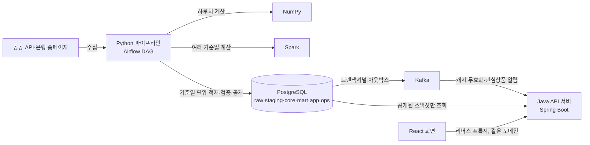

# 금융나침반

예금부터 주식·ETF까지 **수익률과 위험을 같은 기준으로 비교**하고, 사용자의 투자성향에 맞는 상품만 쉽게 알려주는 반응형 웹 서비스입니다.

> **상태**: 설계 단계입니다. 아이디어 기획서, 요구사항 명세서, 아키텍처 설계서(v0.2), ADR을 작성했고, 다음은 데이터 설계(2A)와 화면 설계(2B)입니다. 아직 실행할 수 있는 코드는 없습니다.
>
> **고지**: 2인 팀의 비상업 포트폴리오 프로젝트입니다. 정보 제공과 비교만 하며, 투자를 권유하거나 상품 가입을 중개하지 않습니다. 과거 데이터는 미래 수익을 보장하지 않습니다.

## 왜 만드나

| 문제 | 해결 방향 |
| --- | --- |
| 은행 상품은 금리로, 투자상품은 과거 수익률로 표시되어 위험을 반영한 비교가 어렵다 | 모든 상품을 세후 수익률과 1~6등급 공통 위험등급으로 환산해 한 화면에서 비교 |
| 고령층·청년층·장애인의 금융이해력과 디지털 접근성 격차 | 같은 분석 결과를 일반·시니어·금융초보·시청각장애인 4개 버전으로 제공 |
| 성향에 맞지 않는 고위험 상품 가입(불완전판매) | 판매사와 무관한 중립 분석, 성향을 넘는 상품은 추천에서 제외하고 경고 |

## 주요 기능 (MVP)

- **상품 비교**: 예금·적금·연금저축, 국내 상장 주식·ETF의 세후·연환산·실질 수익률, 변동성, 최대낙폭(MDD), VaR·CVaR, 샤프지수, 1~6등급 공통 위험등급
- **투자성향 진단과 추천**: 금융투자협회 표준투자권유준칙을 참고한 5단계 성향 진단, 적합성 필터 → 조건 필터 → 점수 정렬 → 다양화 순서의 추천, 추천 이유와 주의사항 제공
- **리스크 모델**: EWMA·GARCH(1,1) 변동성 예측, 역사적·가상 스트레스 테스트, 몬테카를로 원금 손실 확률(분산 감소 기법 포함), 분기 VaR 백테스팅, 레버리지·인버스 상품 경고
- **4개 버전**: 글씨 크기, 대비, 정보량, 문체만 다르고 수치는 같습니다. 웹 접근성(KWCAG 2.2) 준수
- **회원 기능**: 비회원도 진단·추천을 모두 이용할 수 있고, 회원은 관심상품 저장과 진단 기록, 관심상품 변동 알림을 받습니다

## 지키는 원칙

- 적합성 필터는 어떤 설정으로도 끌 수 없는 절대 조건입니다. 후보를 만들 때 한 번, 응답 직전에 한 번 더 검사합니다.
- 개별 주식은 분석 정보만 제공하고 추천하지 않습니다. 가입 링크와 수수료 수취 기능을 두지 않습니다.
- 지표를 계산하는 분석 코드는 화면 버전과 회원 정보를 모릅니다.
- 모든 분석 화면에 데이터 기준일과 고지문을 표시합니다.
- 장애 여부, 주민등록번호, 계좌번호, 외국인등록번호는 수집하지 않습니다.

## 아키텍처



- **두 갈래 구조**: 외부 호출과 무거운 계산은 Python 파이프라인이, 사용자 요청과 보안은 Java API 서버가 맡습니다. 두 갈래는 서로의 코드를 호출하지 않고 **DB 스키마, Kafka 이벤트, 공통 설정 파일, 공통 테스트 벡터** 네 가지로만 맞물립니다.
- **검증 후 공개**: 파이프라인은 기준일 단위로 수집 → 표준화 → 검증 → 적재 → 계산 → 공개를 진행합니다. 화면은 상품군별 공개 포인터가 가리키는 스냅샷만 읽습니다. 모든 작업은 기준일을 인자로 받고 다시 실행해도 결과가 같습니다.
- **Kafka·Spark는 하루 공개 경로 밖에** 둡니다. 둘이 멈춰도 공개와 조회는 계속됩니다.
- 아키텍처 규칙은 CI에서 자동 검사(적합도 함수 FF-01~21)로 지킵니다.

## 기술 스택

| 영역 | 기술 | 상태 |
| --- | --- | --- |
| API 서버 | Java + Spring Boot 4.1 (Spring Security, Spring Session JDBC, Flyway) | 채택 (ADR-012). Java 25는 제안 (ADR-010) |
| 데이터 파이프라인·분석 | Python (NumPy, SciPy, arch 등) | 채택 (ADR-012). Python 3.13은 제안 |
| 배치 오케스트레이션 | Apache Airflow 3 | 채택 (ADR-014) |
| 이벤트 | Apache Kafka (KRaft) + 트랜잭셔널 아웃박스 | 채택 (ADR-016) |
| 여러 기준일 계산 | Apache Spark (PySpark) | 채택 (ADR-017) |
| 데이터베이스 | PostgreSQL | 채택 (ADR-002). 18 버전은 제안 |
| 화면 | React + TypeScript | 채택 (ADR-003). 단일 페이지 앱(Vite)은 제안 (ADR-004) |
| 웹 수집 | httpx, BeautifulSoup, Playwright for Python, pdfplumber | 채택 (ADR-012) |
| 배포 | Docker Compose | 서버 환경은 제안 (ADR-006) |
| 제외·보류 | Hadoop(확장 단계), Elasticsearch(조건부), Flink(사용 안 함) | 채택 (ADR-015) |

## 저장소 구조 (계획)

```text
finance-compass/
├── api/        # Java API 서버 (Gradle 멀티 모듈: fc-common, fc-sim, fc-recommend,
│               #   fc-narrative, fc-catalog, fc-member, fc-notify, fc-ops, fc-api)
├── pipeline/   # Python 파이프라인 (fc_common, fc_analytics, fc_collect, fc_pipeline,
│               #   fc_events, fc_spark_jobs, dags)
├── web/        # React 화면
├── docs/       # 기획·요구사항·설계 산출물
└── .claude/    # 개발 보조 설정 (ADR 작성·검토 스킬)
```

## 문서

| 문서 | 내용 |
| --- | --- |
| [아이디어 기획서](<docs/금융나침반 아이디어 기획서.docx>) (FC-PLN-001) | 배경, 기능 52개(MVP Must 27개), 금융공학 모델, 위험 요인 |
| [요구사항 명세서](<docs/금융나침반 요구사항 명세서.docx>) (FC-SRS-001) | 기능·비기능 요구사항, 화면·API, 데이터 파이프라인, 분석·추천 규칙 |
| [아키텍처 결정 기록](<docs/금융나침반 아키텍처 결정 기록 (ADR).docx>) | 기술 선택의 배경, 선택지, 판단 기준, 결과 |
| [아키텍처 설계서](<docs/금융나침반 아키텍처 설계서.docx>) (FC-SAD-001) | 논리·데이터·배치·화면·보안·배포 아키텍처, 적합도 함수 |

`docs/`의 파일은 작업 문서를 내보낸 사본이라 최신본과 다를 수 있습니다.

## 개발 방식

- **단계**: 착수 → 아키텍처 설계 → 데이터 설계(2A)·화면 설계(2B) → 인터페이스 설계 → 상세 설계 → 검토·기준선 순서로 진행하고, 단계마다 대응하는 시험을 미리 정의합니다(V-모델). 구현은 2주 스프린트로 반복합니다.
- **결정 기록**: 아키텍처 결정은 ADR로 남깁니다. 새 ADR은 "제안"으로 시작해 팀 합의로 "채택"하고, 결정을 바꿀 때는 기존 ADR을 고치지 않고 새 ADR로 대체합니다.
- **품질 기준**: 지표 계산값은 기준 데이터셋과 0.01%p 이내, 성향보다 위험한 상품 추천 0건(성향 5개 × 위험등급 6개, 30개 조합 전수 테스트), 추천 API p95 2초 이내, 자동 접근성 검사 오류 0건.

## 데이터 출처

| 데이터 | 출처 | 이용 조건 |
| --- | --- | --- |
| 예금·적금·연금저축 | 금융감독원 금융상품통합비교공시 오픈 API | 무료 인증키 |
| 주식·ETF 일별 시세 | 공공데이터포털 (금융위원회 주식·증권상품 시세정보) | 공공누리 제4유형: 출처 표시, **상업적 이용 금지**, 변경 금지 |
| 기준금리·물가·국고채 금리 | 한국은행 경제통계시스템(ECOS) Open API | 인증키 |
| 은행 상품 상세 | 은행 홈페이지 | robots.txt와 이용약관 준수, 요청 속도 제한, 차단 우회 금지 |

공공누리 제4유형 데이터 때문에 이 프로젝트는 비상업 MVP로만 운영합니다. 상업 서비스로 바꾸려면 유료 데이터로 교체하고 법률 검토를 거쳐야 합니다.

## 팀

| 이름 | 역할 |
| --- | --- |
| (기입) | (기입) |
| (기입) | (기입) |

## 라이선스

프로젝트 라이선스는 아직 정하지 않았습니다.

`.claude/skills/adr/references/`의 참고 자료는 [architecture-decision-record](https://github.com/architecture-decision-record/architecture-decision-record) 저장소에서 가져온 것으로, 원저작물의 라이선스(CC BY-NC-SA 4.0 등)를 따릅니다. 자세한 내용은 `.claude/skills/adr/SOURCE.md`를 봅니다.
